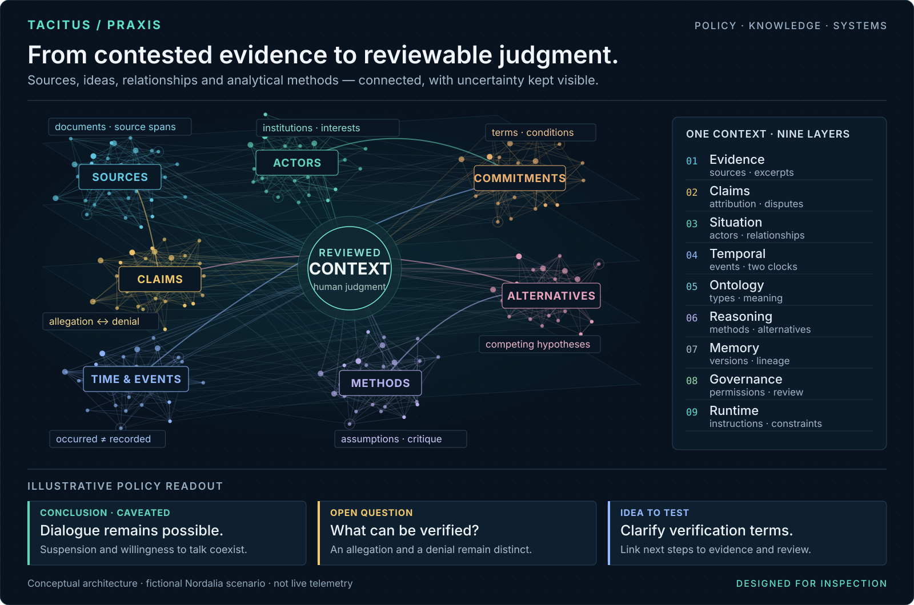

# Giulio Catanzariti

**Foreign policy · Diplomacy · Multilateral affairs**

Former United Nations staffer, based in New York. My focus is foreign policy, international cooperation, and how institutions navigate conflict and disagreement. Columbia University and Sciences Po alumnus.

I’m building **[TACITUS](https://www.tacitus.me)** and **[PRAXIS](https://praxis.tacitus.me)** to bring that focus into practical tools: organizing evidence, tracing commitments, and making policy analysis easier to inspect, challenge, and reuse.

My work connects **political analysis, institutional knowledge, and hands-on software building**. I’m interested in tools that help us understand complex situations, ask better questions, and produce better work.

  

<a href="docs/knowledge-map.md">
  <picture>
    <source media="(max-width: 600px)" srcset="assets/policy-knowledge-map-mobile.svg">
    
  </picture>
</a>

Architecture illustration · fictional policy scenario · [Explore the layers and current capabilities](docs/knowledge-map.md)

## What I’m building

The practical questions guide the tools: **Who said what? What changed? What remains disputed? What can we substantiate?**

| Project | Purpose |
| --- | --- |
| [PRAXIS](https://www.tacitus.me/product/praxis) | A policy workbench: bring documents, review proposed context, attach it to a question, and inspect the sourced answer. In active development. |
| [DIALECTICA](https://github.com/sargonxg/A3_DIALECTICAbyTACITUS_v3) | Organizing documents and evidence into reusable context packages for analysts and AI tools. |
| [AGON](https://github.com/sargonxg/AGON) + [KAIROS](https://github.com/sargonxg/KAIROS-temporal-vision-TACITUS) | Experimental tools for mapping actors, claims, commitments, and the timing of events. |
| [TCGC](https://github.com/sargonxg/TCGC_TACITUS-Conflict-Grammar-Corpus_BENCHMARK) | A benchmark in development for evaluating AI interpretation of policy and conflict texts. |

I work across **Rust, Python, and TypeScript**, from knowledge models and data pipelines to APIs and web interfaces. These repositories document work in progress, with examples, methods, and limitations.

    

## Writing & exchange

At **[Concordia Discors](https://concordiadiscors.org/)**, I write about international affairs, institutions, pluralism, and the human questions behind technology.

- [On minilateralism and institutions that work](https://concordiadiscors.org/on-minilateralism-the-board-of-peace-and-the-unsentimental-case-for-institutions-that-work/)
- [The conflict resolution machine and the human remainder](https://concordiadiscors.org/the-conflict-resolution-machine-and-the-human-remainder/)

For foreign-policy research, collaboration, or a conversation about these tools: **[connect on LinkedIn](https://www.linkedin.com/in/giuliocatanzariti/)**.
