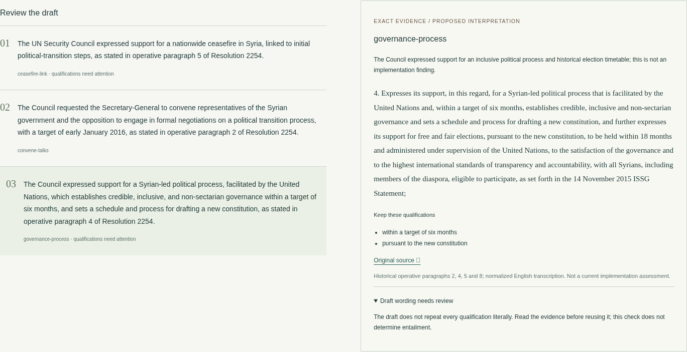

# Giulio Catanzariti

**Multilateral diplomacy · Political analysis · AI for policy**

I’m a former UN Political Affairs Officer on the Syria team. I prepared political analysis and briefings for UN leadership and engaged with diplomats and civil society. I build tools to help diplomats and policy teams compare sources, test assumptions, and trace conclusions back to evidence. [Sciences Po interview](https://www.sciencespo.fr/carrieres/en/news/giulio-catanzariti-political-affairs-officer-syria-team-of-the-un-department-of-political-and-peacebuilding-affairs/)

[LinkedIn](https://www.linkedin.com/in/giuliocatanzariti/) · [Published writing](https://concordiadiscors.org/author/giulio/) · [TACITUS](https://tacitus.me/)


## What I’m building

### DOXA by TACITUS


**Compare how texts frame the same issue.** DOXA runs locally on documents and speech transcripts. Set criteria for political framing or evidence of prejudice, see where a reading is uncertain, and trace each scorecard finding to an exact passage or timestamp.

[Repository and setup](https://github.com/sargonxg/DOXA-by-TACITUS) · [Worked scorecard](https://github.com/sargonxg/DOXA-by-TACITUS#worked-scorecard) · [Download DOXA](https://github.com/sargonxg/DOXA-by-TACITUS/releases/latest)

### Wind Tunnel by TACITUS


**Rehearse a policy or message before fieldwork.** Wind Tunnel lets you compare alternative proposals or wording with the same modeled audience. Use the simulated responses to spot questions worth taking into interviews or surveys, then compare them with the responses you collect.

[Try a quick simulation](https://windtunnel.tacitus.me/quick-simulation) · [Explore worked studies](https://windtunnel.tacitus.me/examples)

### TACITUS App


**Carry the evidence and working context into the next task.** In the TACITUS App pilot, teams save source passages, working assumptions, instructions, and examples. You can select the versions a question needs, preview what will go into the conversation, and share that selection for a teammate to reuse. A context receipt records the selection for review.

[Open the app](https://app.tacitus.me/) · [Try a conversation without signing in](https://app.tacitus.me/try.html)

## Public research tools

- **Middle East political analysis.** Explore historical conflict observations and country data, inspect the sources, and export a cited selection. [Repository](https://github.com/sargonxg/Syria-political-analysis) · [Historical atlas guide](https://github.com/sargonxg/Syria-political-analysis/blob/main/docs/historical-atlas.md)
- **TACITUS Workbench.** Inspect attributed claims and omissions alongside the source passages and reopen a historical research selection. [Repository](https://github.com/sargonxg/tacitus-workbench) · [Syria briefing example](https://github.com/sargonxg/tacitus-workbench/blob/main/apps/workbench/docs/policy-workflow.md)
- **TACITUS Knowledge Pipeline.** Build a source graph, assemble evidence for a specific policy question, and generate a review worksheet locally. [Repository](https://github.com/sargonxg/TACITUS-Knowledge-Pipeline-open) · [Five offline policy workflows](https://github.com/sargonxg/TACITUS-Knowledge-Pipeline-open/blob/main/docs/POLITICAL_TASK_WORKFLOWS.md)

[Browse the TACITUS organization](https://github.com/TACITUS-me) · [Public project map](docs/PUBLIC_PROJECT_MAP.md) · [Research and design notes](docs/RESEARCH_AND_DESIGN.md)

<details>
<summary>See an evidence-linked Syria brief</summary>

Prepare a historical briefing with the reference pipeline, then inspect the draft beside the source passage in Workbench. The example records which context went into the model run and what the reviewer can check. [Briefing workflow](https://github.com/sargonxg/TACITUS-Knowledge-Pipeline-open/blob/main/reference-pipeline/docs/model-workflows.md)



</details>

<details>
<summary>Play the House of Evidence</summary>

The original 8-bit adventure uses a fictional harbor case to practice attributing a statement, preserving a condition, and checking dates before drafting a brief. Run it locally with Python.

```sh
git clone https://github.com/sargonxg/sargonxg.git
cd sargonxg
python -m http.server 8765 --bind 127.0.0.1 --directory tacitus-demo
```

Open [the local game](http://127.0.0.1:8765/). [Game credits and controls](tacitus-demo/CREDITS.md) · [Project guide](TACITUS_GUIDE.md) · [Visual identity](docs/VISUAL_IDENTITY.md)

</details>

## Writing and background

I edit and write for **Concordia Discors**, a magazine on polarization, pluralism, and civic virtue. [The Conflict Resolution Machine and the Human Remainder](https://concordiadiscors.org/the-conflict-resolution-machine-and-the-human-remainder/) · [The Questioner and the Republic](https://concordiadiscors.org/the-questioner-and-the-republic-on-alexander-karps-moral-vision-of-technology/)

I’m developing **Next Diplomacy**, a publication on diplomacy, AI policy, and international cooperation. [Next Diplomacy](https://nextdiplomacy.substack.com/) · [Age of Abundance](https://x.com/AoAbundance)

I’m based in New York and studied at Columbia SIPA, Sciences Po, and LUISS Guido Carli. I’m open to roles in diplomacy, political affairs, and AI governance. [X](https://x.com/CatanzaGi)

<details>
<summary>Project status and verification</summary>

[Current project status](docs/project-status.md) · [Verified workflows](docs/VERIFIED_WORKFLOWS_2026-11-10.md) · [Project roles and verification](docs/PORTFOLIO_REVIEW.md) · [Validation protocol](docs/VALIDATION_PROTOCOL.md)

[Current readiness](docs/FRESH_START.md) · [Repository priorities](docs/REPOSITORY_PRIORITIES.md) · [Growth plan](docs/GROWTH_PLAN.md) · [Engineering review](docs/PORTFOLIO_ENGINEERING_REVIEW_2026-11-07.md) · [Public repository audit](scripts/audit_portfolio.py) · [Profile presentation](docs/PROFILE-PRESENTATION.md)

</details>
