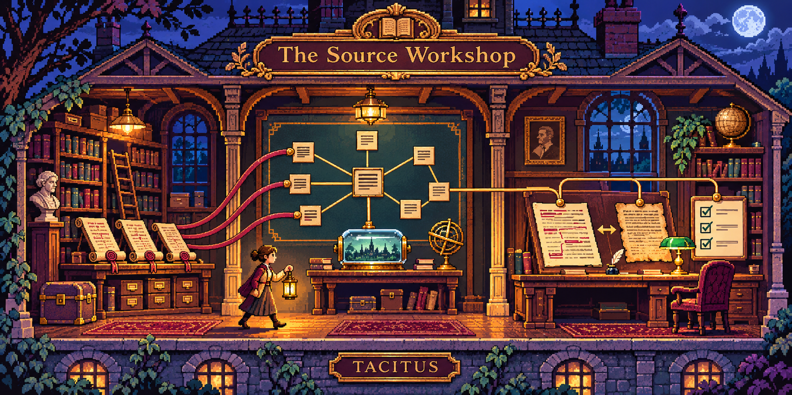
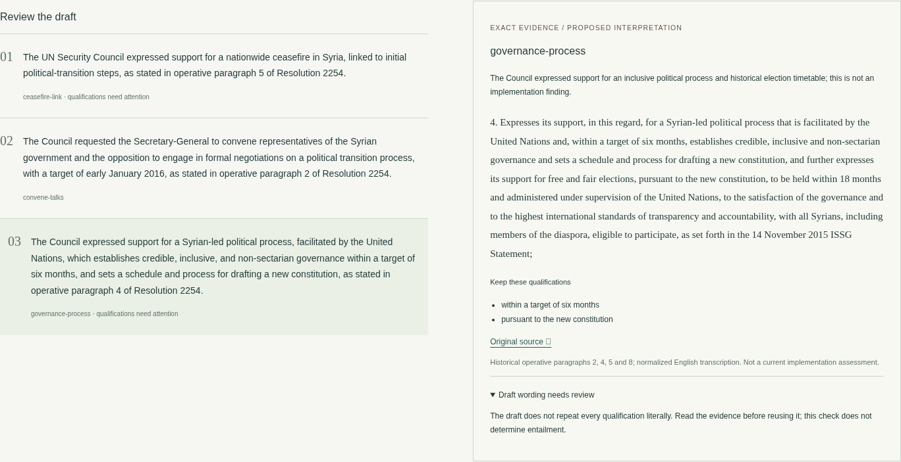

# Giulio Catanzariti

**AI · Diplomacy · Middle East · Multilateralism**

Foreign-policy professional. Former UN Political Affairs Officer, Syria team. Based in New York. Seeking roles in diplomacy, political affairs and AI governance.

Columbia University, Sciences Po and LUISS graduate. My public [Sciences Po interview](https://www.sciencespo.fr/carrieres/en/news/giulio-catanzariti-political-affairs-officer-syria-team-of-the-un-department-of-political-and-peacebuilding-affairs/) describes political analysis, diplomatic engagement and conflict maps supporting the UN Syria team.

[LinkedIn](https://www.linkedin.com/in/giuliocatanzariti/) · [X](https://x.com/CatanzaGi) · [Published writing](https://concordiadiscors.org/author/giulio/)

## Side projects

| Project | My contribution | Status |
| --- | --- | --- |
| [TACITUS](https://www.tacitus.me/) | Independent developer and researcher | Working research tools · PRAXIS paused |
| [Concordia Discors Magazine](https://concordiadiscors.org/) | Editor and contributor | Published |
| [Next Diplomacy](https://nextdiplomacy.substack.com/) | Writer · Publication in development | In development |

TACITUS builds AI data infrastructure for policy and political analysis. Concordia Discors is an editorial project on polarization, pluralism and civic virtue. Next Diplomacy is in development, with an accompanying [Age of Abundance account](https://x.com/AoAbundance).

## What we are building with TACITUS

Policy work repeatedly loses context: a quotation becomes a summary, a conditional promise becomes a fact, a historical source looks current, or a useful research trail disappears inside a chat. TACITUS is my effort to make that work easier to inspect, reuse and improve.

The aim is a practical data layer for people and AI tools: preserve the source, structure who said what and when, select context for a concrete task, and keep the resulting draft attached to its evidence and human review. A researcher should be able to reopen the reasoning materials instead of starting from scratch. A software agent should receive a bounded task and traceable context rather than an unexplained pile of text.

The public tools below already support parts of that loop: historical research selections, source-linked context assembly and evidence inspection. Experimental engines explore portable context, conflict structure and time. Their formats and release gates remain distinct; broader integration and measurable improvements in analytical quality are work in progress. PRAXIS generation and paid upgrades remain paused.

[Why these design choices: papers, methods and upstream credit](docs/RESEARCH_AND_DESIGN.md) · [Public project roles and verification](docs/PORTFOLIO_REVIEW.md) · [Current readiness and 20 refinements](docs/FRESH_START.md) · [A specific next action for each public repository](docs/REPOSITORY_PRIORITIES.md)

### Enter the House of Evidence



The illustration shows the source-to-review workflow. [Artwork, fictional elements and reuse](docs/VISUAL_IDENTITY.md).

Play the separate original 8-bit-style point-and-click adventure: preserve a condition, attribute a statement, check the clock and export a brief with its uncertainty intact. The harbor case is fictional. The game teaches the workflow; it is separate from the research engines.

```sh
git clone https://github.com/sargonxg/sargonxg.git
cd sargonxg
python -m http.server 8765 --bind 127.0.0.1 --directory tacitus-demo
```

Open `http://127.0.0.1:8765/`. No installation, account, model or API key is needed. [Code, credits and controls](tacitus-demo/CREDITS.md) · [Project guide](TACITUS_GUIDE.md).

## Start with the code

| Repository | What you can do | Scope |
| --- | --- | --- |
| [Middle East political analysis](https://github.com/sargonxg/Syria-political-analysis) | Explore 120,576 historical conflict observations and annual country data; inspect sources and export cited selections. | Runnable research tools |
| [TACITUS Workbench](https://github.com/sargonxg/tacitus-workbench) | Inspect source passages, attributed assertions and omissions; reopen historical research selections. | Local tools and browser readers |
| [TACITUS Knowledge Pipeline](https://github.com/sargonxg/TACITUS-Knowledge-Pipeline-open) | Build a source graph, bounded context capsule and review worksheet without a model account. | 42 reference tests; local workflow |

The [TACITUS-me organization](https://github.com/TACITUS-me) offers a task-based starting point and a pinned runnable pipeline alongside the historical source.

Start with the research kit’s [main-branch historical atlas guide](https://github.com/sargonxg/Syria-political-analysis/blob/main/docs/historical-atlas.md).
The [five offline policy task workflows](https://github.com/sargonxg/TACITUS-Knowledge-Pipeline-open/blob/main/docs/POLITICAL_TASK_WORKFLOWS.md)
produce source-linked preparation worksheets and independently verifiable packet receipts without API accounts.

## A working policy-AI example

[Prepare a historical Syria briefing with a bounded evidence-inspection agent](https://github.com/sargonxg/TACITUS-Knowledge-Pipeline-open/blob/main/reference-pipeline/docs/model-workflows.md), then [inspect the real draft and exact evidence in Workbench](https://github.com/sargonxg/tacitus-workbench/blob/main/apps/workbench/docs/policy-workflow.md).



Cloudflare model execution and local evidence checks are recorded. A valid citation does not establish semantic entailment; broader saliency and efficiency benefits remain to be measured. [Research index: 12 primary paper links and implementation notes](https://github.com/sargonxg/TACITUS-Knowledge-Pipeline-open/tree/main/research).

For writing, start with [The Conflict Resolution Machine and the Human Remainder](https://concordiadiscors.org/the-conflict-resolution-machine-and-the-human-remainder/) or [The Questioner and the Republic](https://concordiadiscors.org/the-questioner-and-the-republic-on-alexander-karps-moral-vision-of-technology/), both co-bylined with CDM Editors.

[Project status and experimental work](docs/project-status.md) · [Profile presentation and suggested pins](docs/PROFILE-PRESENTATION.md)

[Engineering review and 30 improvements](docs/PORTFOLIO_ENGINEERING_REVIEW_2026-11-07.md) · [Reproduce the public repository audit](scripts/audit_portfolio.py)

[Browse all public projects, prototypes and upstream references](docs/PUBLIC_PROJECT_MAP.md) · [Verified workflows and measured limits](docs/VERIFIED_WORKFLOWS_2026-11-10.md)
