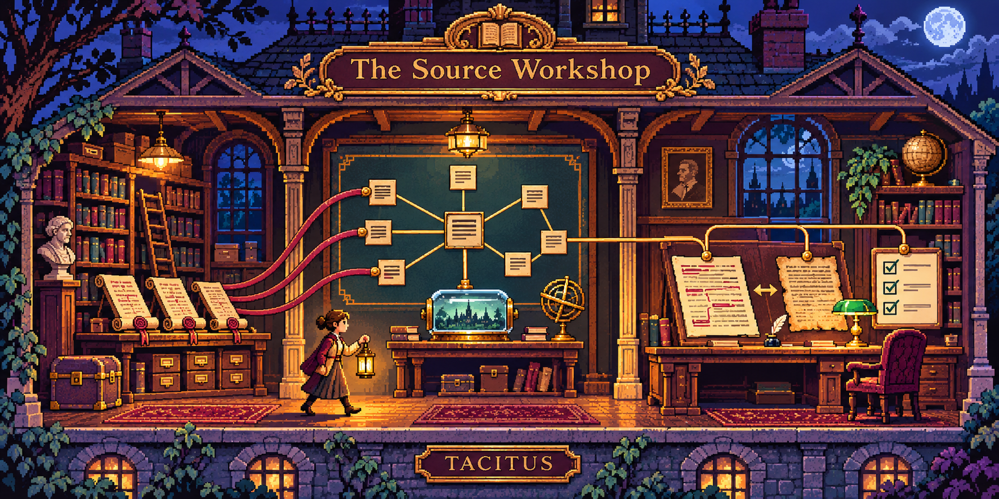
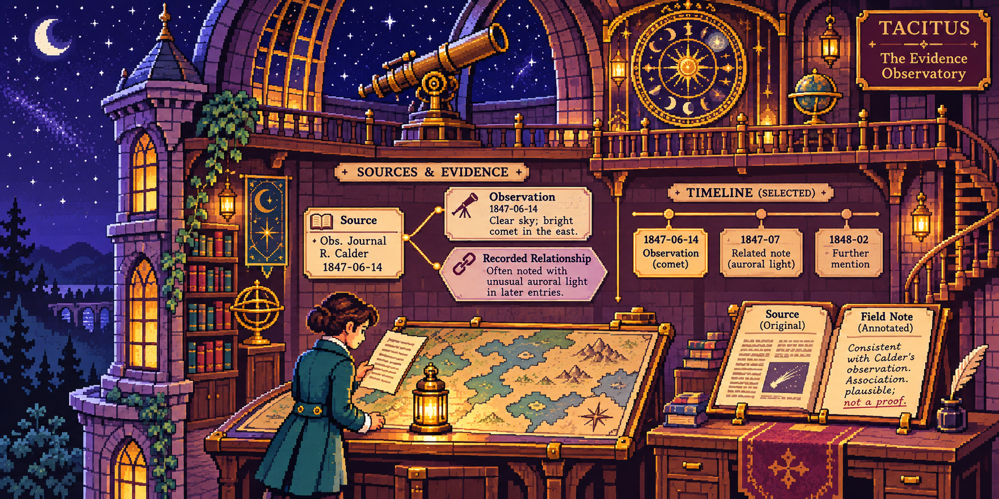

# TACITUS visual identity: evidence you can inspect

Original illustrations generated with OpenAI image generation on 12 November 2026. They draw on the broad visual language of 1980s point-and-click adventures. No existing game assets, characters or specific scenes were copied.

## The Source Workshop

Use for source capture, graph/context compilation, evidence validation and artifact inspection. The papers, graph, capsule and reviewer are a concept illustration, not an application screenshot or proof of a deployed feature.

## The Evidence Observatory

Use for historical atlases, source comparison and temporal research. The astronomer, map, dates and observations in the illustration are fictional; they are not an archival astronomical record or a claim about the research datasets.

## Where the style belongs

- Authored TACITUS tools: choose an illustration that explains the actual workflow, with useful alternative text and an explicit concept-art caption.
- Playable demonstrations: retain working controls, honest synthetic data and a path to the real code/output. A picture alone is not a game or an implementation demo.
- Screenshots: label genuine application captures separately and retain the date, fixture/source context and acceptance limits.
- Upstream forks: preserve the upstream project's identity and attribution; keep optional TACITUS teaching material secondary.
- Historical archives and independent personal work: preserve their purpose and visual identity. Artwork should not suggest renewed maintenance or production acceptance.

The original four-room **House of Evidence** adventure remains separate. Its engine and synthetic teaching brief are documented in [the game credits](../tacitus-demo/CREDITS.md). A teaching export is not a native Context, DIALECTICA, Graph or App import. Existing project/source licenses remain authoritative.

## Reuse receipt

- `tacitus-source-workshop-8bit.png` — SHA-256 `69f70f05b35807fc7d8af90f16b65bb398802d29b932c759a8b46de5387dbffd`.
- `tacitus-evidence-observatory-8bit.png` — SHA-256 `f85438be2f1d29850bee9f05683e34c5f688cdc89cdc364bf3a9aa6ae5cbbdb9`.
