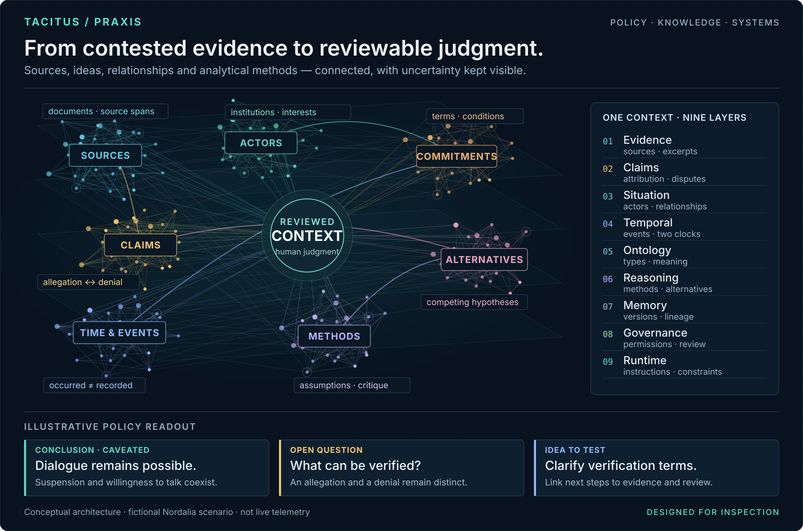

# From evidence to reviewable judgment

This is an **architecture illustration**, not a product screenshot, a measured benchmark, or a graph extracted from a real diplomatic file. The dense topology illustrates relationships across knowledge layers. The example readout draws on the fictional Nordalia case used on the [TACITUS website](https://www.tacitus.me/).

The practical idea: a policy assessment should connect what sources say, who is involved, what changed, how the analyst reasoned, and what remains uncertain. A claim, a conclusion, and an idea for action are different objects.

## Read the structure

| Layer | Question |
| --- | --- |
| Evidence | Where did this come from? |
| Claims | Who asserts it, and who disputes it? |
| Situation | Which actors, interests and commitments connect? |
| Temporal | When did it happen, and when was it known? |
| Ontology | What do the terms and relationships mean? |
| Reasoning | Which method, assumptions and alternatives shaped the assessment? |
| Memory | What changed between versions? |
| Governance | Who reviewed it, and for what use? |
| Runtime | Which instructions and constraints should guide an AI tool? |

The nine layers follow the public [TACITUS capsule design](https://www.tacitus.me/capsules) and [DIALECTICA reference graph](https://github.com/sargonxg/A3_DIALECTICAbyTACITUS_v3/blob/main/fixtures/canonical-capsules/conflict-situation-capsule/graph.jsonld). They describe the architecture; they do not imply that every layer is complete in the live application.

## Current project boundaries

**TACITUS** is the independent AI data-infrastructure project for policy and political analysis. **PRAXIS**, its agentic workspace, is paused; sign-in remains invitation-only, and AI generation and paid upgrades are unavailable. Public recorded demonstrations and separate local tools remain available. **DIALECTICA** explores capsule compilation; **AGON** and **KAIROS** explore conflict structure and chronology; **TCGC** provides an alpha corpus and evaluation toolkit.

The **29 September 2026** review recorded a narrow functional checkpoint: document upload, proposal review, capsule attachment, a sourced answer and saved history. That historical result does not establish current generation availability or a production service. Full portable context preservation, conversational ontology authoring, delegated research completion and expert evaluation of analysis quality remain development work.

Inspect the [public PRAXIS explanation and recorded tour](https://www.tacitus.me/product/praxis), the [standalone Workbench](https://github.com/sargonxg/tacitus-workbench), and the [Middle East research kit](https://github.com/sargonxg/Syria-political-analysis). Their exported context formats and acceptance boundaries differ; this architecture illustration does not establish interoperability between them. The [project map](project-status.md) records the current scope.

## Reproduce the visual

Run `python scripts/render_knowledge_map.py` from this repository. The renderer uses only the Python standard library, a fixed seed, editable vector text and no external image services.
